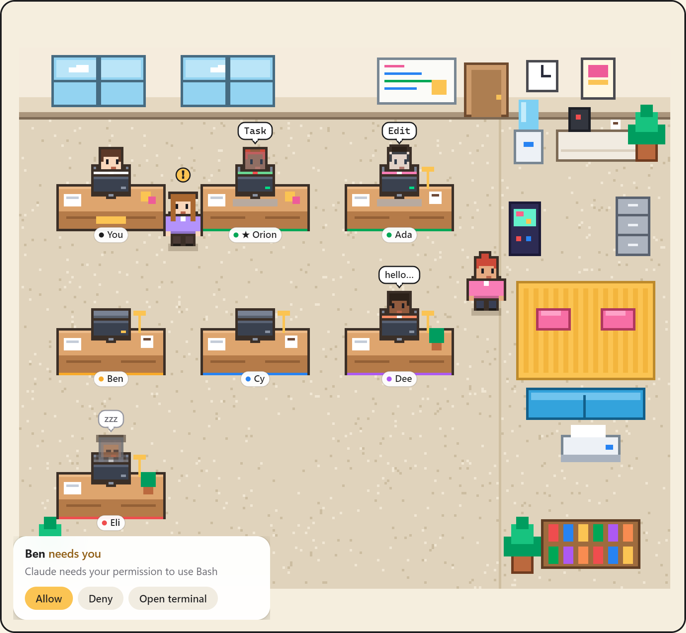

<div align="center">

# Hivedesk

**A tiny pixel office where your AI coding agents actually work.**

Hire Claude Code, Codex, Gemini CLI or Copilot CLI agents, watch them sit at their desks, walk to the water cooler,
message each other, and come find *you* when they need permission.




</div>

---

## What is this?

Hivedesk is a local, Windows-first **multi-agent harness**. Every agent is a *real* coding CLI running in a real
pseudo-terminal, not a simulation. They share an on-disk "hive" (messages, memory, a board, a task list), and an
orchestrator agent (**Orion**) can delegate work to the rest of the team. You stay in the loop: you can type into any
agent's terminal, brief Orion, assign tasks, and answer questions.

What makes it fun is the **office**: each agent is a small character whose behaviour is driven by what the agent is
*really* doing, so you can read the state of your whole team at a glance.

It is inspired by the open-source (MIT) [Munder Difflin](https://github.com/HarnessMD/munder-difflin) harness and
re-implements its core design in a much smaller codebase. See [SPEC.md](SPEC.md) for what was kept and what was left out.

## Meet the team

| What the agent is doing | What you see in the office |
| --- | --- |
| **Starting** | Walks in through the door and says "hello…" |
| **Working** | Sits at its desk typing, laptop glowing, with a bubble showing the tool it is using (`Edit`, `Bash`, …) |
| **Idle** | Wanders: water cooler, coffee machine, couch, printer, or a chat at a colleague's desk |
| **Needs you** | Walks over to *your* desk with a pulsing **!** and a permission card appears |
| **Sent a message** | A paper letter flies from the sender to the recipient |
| **Exited / error** | Slumps at the desk, greyed out (`zzz` / `error`) |
| **Stopped** | Walks out through the door |

Hover a character for details (role, engine, model, last tool, unread mail). Click one to open its terminal. Click
your own character to open **Ask me**.

### Asking for permission

When a Claude Code agent hits a permission prompt, its `Notification` hook tells Hivedesk, and a card shows the agent's
actual request:

```
Ben needs you
Claude needs your permission to use Bash
[ Allow ]  [ Deny ]  [ Open terminal ]
```

- **Allow** sends <kbd>Enter</kbd> to that agent's terminal (accepts the dialog's default "Yes").
- **Deny** sends <kbd>Esc</kbd> (cancels the dialog).
- Both only ever happen **when you click**. Hivedesk never answers a prompt for you.
- For folder-trust menus, update offers, confirmations and every non-Claude engine, the card only offers
  **Open terminal**, because Hivedesk cannot be sure what the menu is asking.

## Features

- **Real agents**: Claude Code, OpenAI Codex, Gemini CLI, GitHub Copilot CLI, a PowerShell shell, or any custom command.
  They use your own logins; Hivedesk never touches credentials.
- **Shared hive**: `inbox/outbox` messages, per-agent `memory.md`, a shared `board.md`, `tasks.json` and an append-only log,
  all plain files you can read and edit.
- **Orchestrator**: Orion delegates by message and can spawn new workers on request.
- **Autonomy loop**: a Claude agent that finishes a turn with unread mail is told to keep going; idle agents of any engine
  are woken with a short notice typed into their terminal.
- **Your desk**: brief the orchestrator, hire agents, run a kanban **Tasks** board, answer **Ask me**, search **Memory**,
  watch the **Log**, and use the full xterm **Terminal** of any agent.
- **Autonomy levels** per agent: ask before acting, accept file edits (default), or full auto.
- **Model and effort bar**: open any Claude agent's **Terminal** tab and switch its model (Fable, Opus, Sonnet, Haiku or any id)
  and effort (Low to Max) with one click. A running agent gets `/model` and `/effort` typed for it as soon as it is idle;
  the choice is also saved, so the next start launches with `--model` and `--effort`.
- **Claude Code mirror**: the **Claude Code** tab shows every chat you run in Claude Code (terminal, desktop app or IDE) live and
  read-only, by reading the transcripts Claude Code already writes under `~/.claude/projects`. Nothing in your Claude settings
  is changed. **Delegate to agent** sends that chat's last prompt, or a task you type, to any Hivedesk agent.
- **Designer**: a one-click **+ Designer** hire in the Hire dialog: a head designer whose standing instructions tell it to use the
  `apple-design`, `impeccable`, `ui-ux-pro-max` and other design skills you have installed, set direction and review UI work.
- **Audit trail**: the app is the only git committer of the hive, so every change to it is a commit (if `git` is installed).

## Get it

### Option A: download the app

Grab `Hivedesk-<version>-portable.exe` (no install, just double-click) or `Hivedesk-<version>-setup.exe` from the
repository's **Releases** page.

> The executables are **not code-signed**, so Windows SmartScreen may show "Windows protected your PC".
> Choose **More info → Run anyway**, or build it yourself with Option B.

### Option B: build it

You need Windows 10/11 and [Node.js](https://nodejs.org) 18 or newer.

```bash
npm install
npm start          # run from source
npm run dist       # build the exes into dist/
```

`npm run dist` produces `dist/Hivedesk-<version>-portable.exe` and `dist/Hivedesk-<version>-setup.exe`.

### Publishing a release (maintainers)

Pushing a tag such as `v0.1.0` runs [`.github/workflows/release.yml`](.github/workflows/release.yml), which tests, builds
and attaches both exes to a GitHub Release. Pushes and pull requests run [`ci.yml`](.github/workflows/ci.yml).

## First run

1. **Install and log in to the CLIs you want once, in a normal terminal**: `claude` (then `/login`), `codex login`, and so on.
   Hivedesk starts them; it does not install them.
2. **Answer the folder-trust prompt.** The first time an agent opens a folder, Claude Code and Codex ask whether you trust it.
   The agent shows **Needs you**: click it, open **Terminal**, and choose. Hivedesk never answers trust, update or
   confirmation menus for you.
3. Keep your CLIs up to date. An outdated Codex shows an update menu (flagged **Needs you**) and may reject newer models.
4. Orion is hired automatically on first start (toggle it in **Settings**). Brief Orion from the panel on the right.

## How it works

```
you ──brief──► Orion (orchestrator)
                   │ messages via outbox/ → router → inbox/
        ┌──────────┼──────────┐
        ▼          ▼          ▼
      agent      agent      agent        each = a real CLI in a pseudo-terminal
        └── shared hive: memory · inbox/outbox · board.md · tasks.json · log.jsonl ──┘
```

- **Hive** (`<workspace>/hive`, default `Documents/Hivedesk/hive`): `PROTOCOL.md`, `registry.json`, `board.md`,
  `tasks.json`, `log.jsonl`, and `agents/<id>/{identity.md, memory.md, inbox/, outbox/}`.
- **Messages**: an agent writes one JSON file to its `outbox/` (`to`, `act`, `subject`, `body`); the router delivers it to
  the recipient's `inbox/`. `to` can be an agent id or name, `god`, `broadcast` or `human`. Replies count hops; past 8 hops
  a thread is escalated to you.
- **Status** comes from Claude Code lifecycle hooks (forwarded to a token-protected loopback HTTP server) and, for other
  engines, from terminal activity. The office simply renders that status.
- **Spawning**: the orchestrator can start workers by writing `spawn-requests/<id>.json`
  (`name`, `role`, `objective`, optional `cwd`, `provider`).

## Team tab: build production software with a hierarchy

The **Team** tab is the management view.

- **Chain of command.** You > the orchestrator (god) > managers > employees. Every agent has a "reports to" manager (default: the orchestrator). Agents report up; the orchestrator sends you `Report:` messages at milestones, like a manager reporting to a senior. Archiving a manager moves their reports up one level.
- **Build software.** Describe a product, pick the roles, and **Assemble team & start** hires the missing leads under the right managers and briefs the orchestrator with the GStack playbook. It asks for confirmation first and says how many agent processes it will start.
- **Crew library.** Ten pre-made leads: Product Lead, Tech Lead, Designer, Frontend Lead, Backend Lead, Code Reviewer, QA Tester, SOC Analyst, Deployment Lead, Tech Writer. Each carries GStack (`/office-hours`, `/plan-eng-review`, `/review`, `/qa`, `/cso`, `/ship`, `/land-and-deploy`, `/canary`, `/retro`) and ECC skill instructions. **Customize** edits the template (name, role, model, effort, autonomy, manager, instructions) and **Reset** restores it.
- **Customize any hired agent** from the org chart or the Terminal header: rename, model, effort, autonomy, manager, instructions. Model and effort apply live to a running Claude agent; the rest apply on its next start.
- **Workflow.** Think > Plan > Contract > Build > Review > Test > Secure > Ship > Reflect. The Frontend Lead works with the Designer (visuals, review) and agrees `CONTRACT.md` with the Backend Lead before building. Deployment is gated on QA, review and security, and always needs your approval.
- **Coding method.** Every agent prompt includes the Cavemen + Ponytail method: minimal tokens (TARGET > INSPECT > IMPLEMENT > TEST > VERIFY) and the smallest correct change (YAGNI, existing code and the standard library first, smallest diff, root-cause fixes).

Status: Implemented. Skill names that are not installed on your machine are skipped by the agents.

### Rooms on the floor
The pixel office is rooms joined by hallways: **Your office** (desk, bookshelf, sofa), the orchestrator's office, one room per team (Product & Design, Engineering, Security, Deployment, Research Dept, General) and the locked **Secret office**. A room is a lead plus everyone under them, so the layout follows the real reporting lines. Waiting agents walk into your office to ask you.

### Kill, knowledge base, research department, secret office
- **Kill** (Terminal header and org chart; never the orchestrator) permanently deletes an agent: its hive folder (memory, knowledge, inbox, outbox) and its own Claude Code transcript, after a confirmation. The activity log and the hive's git history keep a trace. **Archive** stays the non-destructive option.
- **Knowledge tab:** per-agent notes (`hive/agents/<id>/knowledge/*.md|txt`) you write and edit. Every agent's prompt points at its folder.
- **Research department** (Team tab > Hire research dept): Research Lead, Web Scraper, Research Analyst, using `agent-reach`, `scrapling-official`, `playwright-cli` and the ECC research skills. Web rules are built in: public pages only, robots.txt and rate limits respected, no CAPTCHA/login/bot-detection bypass, no bulk personal data, sources cited.
- **Secret office** (Secret office tab): a private analyst on your local model that reports only to you. Other agents cannot see or message it, and **every message it sends to an agent is held in your inbox**: nothing is implemented until you click **Approve & dispatch** (choose who carries it out) or **Reject**. You can also assign tasks directly to any agent, and set any agent's manager to **You** so you manage it yourself.

### Optional local model (Ollama)
Settings > Local model. Off by default. When enabled, the engine **Claude Code (local model)** runs the normal `claude` CLI against your local Ollama server, with every model tier mapped to the local model. **Set up** imports your `.gguf` into Ollama under its own name with a Claude-Code-sized context (it does not touch your own Modelfile; a Modelfile with `num_ctx 1024` cannot work with Claude Code). **Test tool calling** sends one real tool request, because Claude Code needs tool support. Hivedesk starts `ollama serve` itself when a local agent starts, with flash attention and a q8 KV cache. Expect slow answers from a 27B model on an 8 GB GPU.

## Autonomy levels

| Setting | Claude Code | Codex |
| --- | --- | --- |
| Ask before acting | default prompts | `--sandbox workspace-write --ask-for-approval untrusted` |
| Accept file edits (default) | `--permission-mode acceptEdits` | `--sandbox workspace-write --ask-for-approval on-request` |
| Full auto | `--dangerously-skip-permissions` | `--dangerously-bypass-approvals-and-sandbox` |

Full auto lets an agent run any command without asking. Use it only in folders you are happy to have changed.

## Project layout

```
src/main/hive.js        on-disk hive: registry, messages, router, tasks, memory
src/main/agents.js      PTY agents, provider launch flags, Claude hooks, waking
src/main/main.js        Electron main: hook server, router loop, git, IPC
src/preload.js          window.hd bridge
src/renderer/office.js  the pixel office (canvas, no image assets)
src/renderer/app.js     UI: agent list, terminals, tasks, board, memory, ask-me, log
test/                   node:test unit tests
docs/screenshots/       README images
```

The whole office is drawn with rectangles on a `<canvas>`: characters, desks, plants, the water cooler. Walking uses a small
waypoint graph, and the layout adds desk columns as the window gets wider.

## Troubleshooting

| Symptom | Fix |
| --- | --- |
| `"claude" was not found on PATH` | Install the CLI and restart Hivedesk so it sees the new `PATH`. |
| An agent is stuck on **Needs you** | Open its **Terminal**; it is waiting on a trust / update / confirmation menu. |
| No **Allow / Deny** buttons on a card | They only appear for Claude Code permission prompts. Use **Open terminal** otherwise. |
| SmartScreen warning on the exe | The build is unsigned. **More info → Run anyway**, or build from source. |
| Nothing is committed to the hive | Install `git`, or enable "Commit the hive to git" in **Settings**. |

## Contributing

Issues and pull requests are welcome. See [CONTRIBUTING.md](CONTRIBUTING.md). Run `npm test` before opening a PR.

## Credits

- Concept and core design inspired by [Munder Difflin](https://github.com/HarnessMD/munder-difflin) (MIT).
- Interface designed with Google Stitch ("Sequoia Dark Workspace"), see
  [`docs/screenshots/stitch-reference.png`](docs/screenshots/stitch-reference.png).
- Terminals by [xterm.js](https://xtermjs.org) and [node-pty](https://github.com/microsoft/node-pty) (via `@lydell/node-pty`).

## License

[MIT](LICENSE)
